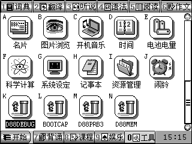
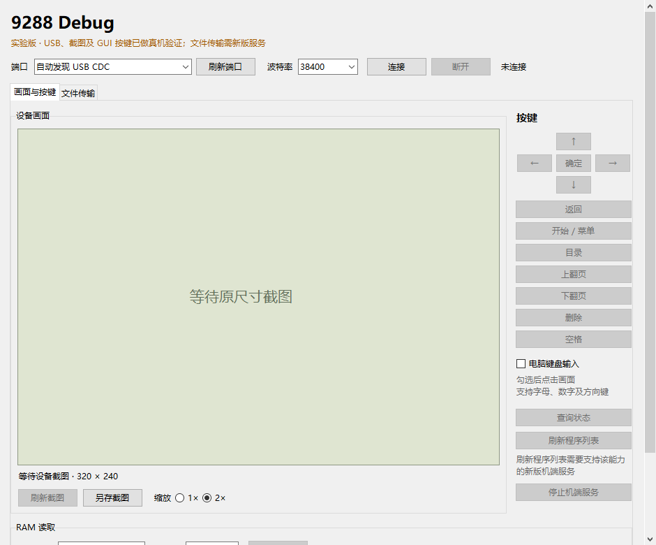

# BBK9288 Debug

面向**原版步步高 9288**的实验性 USB 调试器。机端程序显示为 **D88DEBUG**，启动后驻留系统堆，返回菜单后仍可由电脑截图、发送原生 GUI 按键、读取 RAM 和传输文件。

这是 S1C33 / KF2 EXE 项目，**不适用于 9288T、9288S、H1 或 9588**。当前只接受已采集的 `CAPTURED-0215EBC4` 固件配置，内部版本字符串为 V1.3；函数表和代码指纹不匹配时会拒绝接管。设备外观或安装包版本号不能单独证明兼容。

## 快速开始

在本仓库右侧 **Releases** 下载 `v0.2.0` 预发布的 Windows ZIP，并按随包 `SHA256SUMS.txt` 核对文件。机端 `9288Debug.exe` 与电脑端 `9288Debug-PC.exe` 是两种程序。

1. 在 9288 上进入原生 USB 磁盘模式，把 ZIP 内 `device/系统/程序/9288Debug.exe` 复制到设备卷的 **`系统/程序/9288Debug.exe`**。
2. 等待复制结束，在 Windows 安全弹出磁盘，然后在 **9288 上退出 USB 磁盘界面**。USB 线可以一直插着供电。
3. 在机端程序菜单运行 **D88DEBUG**。看到 **D88DEBUG READY** 后确认并返回菜单。
4. 在 Windows 运行 ZIP 中 `pc/9288Debug-PC.exe`，刷新并选择该 9288 的 COM 端口，先连接和查看状态，再尝试截图或单次按键。COM 号不固定。

更换设备端构建时，必须正常重启 9288，清除旧驻留后再运行新版。仅覆盖文件不能替换正在驻留的代码。

### 基本操作

- **截图**：当前已验证的 320×240 LCD 模式，输出灰度图。
- **按键**：排队发送一组原生 GUI DOWN/UP；排队成功不代表程序已经处理。直接读键盘矩阵的游戏可能不响应。
- **刷新程序列表**：新增独立按钮与 `refresh-apps` 命令，调用已核对的原生固件扫描器并排队重绘。需先回到系统菜单；上传 `A:\系统\程序\*.exe` 成功后可自动刷新。刷新结果与上传结果分别报告，详见[刷新说明](docs/app-refresh.md)。
- **文件传输**：输入已知完整 `A:\` 路径，支持上传、下载、取消和显式替换，带分块 CRC、完整 CRC 和提交回读。目录必须已存在；当前不提供目录浏览。
- **RAM**：只读允许的 SDRAM 范围；写入仅限自己的 512 字节 scratch 区，不提供任意代码执行。
- **停止**：电脑发送 STOP，或机端再运行一次 D88DEBUG。回复只是停止回执，USB 恢复随后完成。USB 可继续供电；当前构建的真机 STOP/磁盘恢复仍需补测，必要时正常重启。

服务会刷新已核对的自动关机空闲计数，保留用户设置。旧构建曾通过 331 秒空闲验证；当前构建未重复该时长测试，见[验证记录](docs/validation.md)。

### 从源码运行电脑客户端

需要 Python 3.11 或更新版本及 Tcl/Tk。独立 EXE 目前只发布 Windows 版。

```powershell
git clone https://github.com/HelloClyde/BBK9288-debug.git
cd BBK9288-debug
python -m pip install -r requirements.txt
python -m host.gui
python -m host.client list
python -m host.client --port COM3 status
```

按本机实际端口替换 COM3。文件传输和按键示例：

```powershell
python -m host.client --port COM3 file-put .\demo.bin 'A:\demo.bin'
python -m host.client --port COM3 file-get 'A:\demo.bin' .\readback.bin
python -m host.client --port COM3 press LEFT
python -m host.client --port COM3 refresh-apps
python -m host.client --port COM3 file-put .\demo.exe 'A:\系统\程序\demo.exe' --refresh-apps
```

上传默认拒绝同名目标；替换需显式加 `--replace`。若返回 `RECOVERY (-714)`，保留报告中的恢复路径和设备现场，按[文件传输说明](docs/file-transfer.md)处理，不要自动重传或删除临时文件。

## 截图

以下为本项目真实截图。设备图来自真机 LCD 读回；电脑图为未连接状态的本地 Tk 窗口，来源和构建范围见[验证记录](docs/validation.md)。





## 构建

推荐 Windows x64、Python 3.12，使用固定依赖入口。**不需要 9588 BDA SDK，也没有 SDK 子模块需要初始化**：9288 使用另一套 ABI 和头文件；本仓库不把许可未明确开放的厂商 SDK 纳入 Git。

```powershell
python -m pip install -r requirements-build.txt
python scripts/fetch_build_dependencies.py
python scripts/build_release.py
```

默认下载到 `build/dependencies`。下载经过固定 SHA-256 校验，仅提取所需头文件和已验证工具链，不提取 ROM、原厂打包器和图标。也可显式指定依赖：

```powershell
python scripts/build_release.py --sdk build/dependencies/sdk --toolchain build/dependencies/toolchain
```

输出位于 `dist/release`，包括机端 EXE、Windows 客户端、安装 ZIP、构建报告及 SHA-256 清单。构建也会更新 `dist/9288Debug-PC.exe`，可双击根目录的 `启动9288Debug.cmd` 打开本次客户端。设备编译检查 ABI、驻留重定位和多地址独立链接，KF2 包装使用可再生图标。实际参数见 `python scripts/build_release.py --help`。

常规测试不连接设备，不要求私有固件：

```powershell
python -m unittest discover -s tests -p "test_*.py" -v
```

主机 C 模型测试需要 GCC。可选编译测试通过 `D88_TOOLCHAIN` 指定 S1C33 工具链目录；CI 也执行这些编译测试。私有固件对照会明确跳过，不作为公开 CI 的真机证据。

低层历史构建器以及 D88PRB3、D88MEM、D88MAP 实验源码一并保留；首版交付聚焦驻留调试服务和电脑客户端。旧构建器的开发机默认路径不是公开构建入口，请使用上面的 `scripts/` 命令。历史排查见[开发记录](docs/development-history.md)。

## 依赖

| 用途 | 依赖 |
| --- | --- |
| 使用成品 | 受支持固件的原版 9288、USB 数据线、Windows CDC 串口支持 |
| 源码客户端 | Python ≥3.11、Tcl/Tk、pyserial、Pillow |
| 设备构建 | 固定版本 BBK 9288 头文件、已补 GNU33 ABI 的 S1C33 LLVM、pyelftools |
| Windows 打包 | PyInstaller 6.x |
| 主机模型回归 | GCC；可选工具链/私有固件测试另列 |

固定来源、提交、校验值及第三方许可见[依赖说明](docs/dependencies.md)与[NOTICE](NOTICE.md)。SDK、工具链、原厂固件、NAND、私人采集、用户存档不随源码仓库分发。

## 验证范围

v0.1.0 的历史基线为 `image_id=f9dc2295`，其原版 EXE 在真机通过 5 次普通重连、20 KiB 文件上传/下载/替换/取消、同名文件保护、GUI 左右键及截图恢复，最终 1294 次请求、0 错误。

v0.2.0 新增固件扫描作业，设备运行时已经变化，不能沿用“与旧真机载荷相同”的验证声明。本版按[运行时记录](docs/runtime-validation.json)绑定映像身份和 SHA，主机回归、S1C33 编译/重定位、原生 GUI1 扫描模型与真机测试分别记录。当前版本验证范围见[刷新说明](docs/app-refresh.md)和[验证记录](docs/validation.md)；STOP/原生磁盘恢复及长期关机恢复的旧边界仍保留。

## 感谢

感谢 [H1Debug](https://github.com/HelloClyde/BBKH1-debug) 提供后台 USB 调试器的设计参考，感谢 [autch/llvm-s1c33](https://github.com/autch/llvm-s1c33) 和 [GAMForge](https://github.com/HelloClyde/gamforge) 的 S1C33 工具链工作，以及提供真机、操作反馈和持续验证的用户。BBK SDK 与 Epson 手册提供了设备接口和硬件资料。

## 许可

自有代码为 **GPL-3.0-only**，见[LICENSE](LICENSE)。第三方 SDK、编译器和运行时分别适用其原有许可，见[NOTICE](NOTICE.md)。
