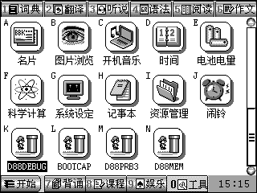
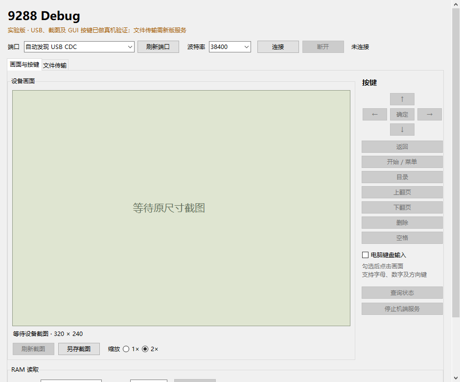

# 验证记录与边界

本项目分别记录主机模型、S1C33 编译、原生固件模型和物理设备测试。编译成功不等于真机 USB、文件系统或停止恢复已通过。机器可读摘要见 [validation-evidence.json](validation-evidence.json)。

## v0.1.0 历史真机基线

2026-11-05 在原版 9288 上测试的驻留服务：

| 项目 | 值 |
| --- | --- |
| 固件配置 | `CAPTURED-0215EBC4`，采集内核内部版本字符串 `V1.3` |
| image_id | `f9dc2295` |
| 设备 EXE 大小 | 70,701 字节 |
| 设备 EXE SHA-256 | `8c62087ffa40fb44b3d602970c81fad47c2999039b2ce90e2cc9c60eb6e9867c` |
| 核心源码指纹 | `8f5f410827927205d8b257fdbb11982d0ae5df3eb573eb0f7f27cec56a037672` |

该次使用普通客户端连续重连 5 次，没有增加 DTR 等待；20 KiB 文件的上传、下载、替换、取消及已有文件保护通过。单次原生桌面 LEFT、RIGHT 已按截图核对，RIGHT 返回后与原图逐像素一致。最终记录为 1,294 次请求、0 错误，快照已释放，USB 线保持连接。

该构建尚未在物理设备上重新完成 STOP 后原生 USB 磁盘恢复，也没有重复长期无操作自动关机实验。历史构建 `d7af4f73` 的 331.078 秒无指令待机记录属于另一版本，不能充作当前构建的新测试。16 MiB 协议上限也没有在这次 20 KiB 真机传输中测到。

v0.1.0 首次开源发布使用新的自制图标重新生成 KF2 容器。固定公开依赖重建的设备文件仍为 70,701 字节，SHA-256 为 `eff3fdbc7b563122f4377ffa5e125fd9829eb5e8dd276c042c20fa212c06dd88`。

KF2 代码偏移为 536，重建载荷 SHA-256 为 `f86c57e384562547e5af756439b3298e08dde9b5ea2957e662e4ad858800c402`，与历史真机文件载荷逐字节一致，image_id 仍为 `f9dc2295`。独立容器检查确认标题、分类、入口偏移、两图标及文件边界有效；原 SDK 图标未被分发。

这些比对证明核心一致、封装通过检查，不等于对新容器进行了新的真机运行测试。发布文件最终摘要以 Release 校验清单为准。

## v0.2.0 刷新功能

当前设备运行时已增加新作业，映像身份和载荷摘要以 [runtime-validation.json](runtime-validation.json) 为准。 本轮共 302 项测试，296 项通过、6 项私有固件对照跳过；新版真机已验证手动刷新、程序上传后自动刷新、缓存分类更新与恢复、活动 GET 互斥、重复扫描及三次重连，错误数 0，原诊断文件完整恢复。机器可读记录见 [app-refresh-validation.json](app-refresh-validation.json)。历史 `f9dc2295` 的全文件/载荷相等性不再作为新版通过条件。刷新作业已通过普通 C 模型、真实 S1C33 编译/重定位和原生 GUI1/文件系统集成模型；新物理验证进展与明确范围见[刷新说明](app-refresh.md)。

## 真实截图

以下真机截图由该次 `f9dc2295` 调试服务读取，原尺寸 320×240；它展示服务已驻留后返回原生桌面的状态。



以下是 Windows 源码版 Tk 客户端的实际界面，处于**未连接**状态；此图用于展示界面，不作为已连接或文件传输完成的证据。



两张图均直接复制原始 PNG，没有更换画面内容；它们不包含存档、用户文档或固件字节列表。

## v0.1.0 开源副本的自动测试

2026-11-07，在只包含公开源码的副本中执行：

```powershell
# 先将本机 GCC 加入 PATH；D88_GCC 可显式指定其可执行文件。
$env:D88_TOOLCHAIN = (Resolve-Path build/dependencies/toolchain).Path
python -m unittest discover -s tests -p "test_*.py" -v
```

结果：核心测试 **266 项，260 项通过，6 项跳过**；加入本次独立 KF2 包装的 4 项回归后，最终为 **270 项，264 项通过，6 项跳过，0 失败，0 错误**。本次运行启用了 BBK R6–R9/R4 ABI 补丁的 S1C33 工具链，包含严格目标编译、独立重定位链接及加载器测试；生产 C 代码的协议、USB 寄存器模型、文件事务、输入队列、自动关机保活和异常清理使用主机 GCC 执行。

六项跳过均为与私有采集固件字节对照的可选测试。固件、NAND 和 RAM 转储不随仓库提供，缺少这些文件时明确跳过。常规自动测试不会访问物理串口、操作设备磁盘或启动私人 NAND 模拟器。

测试编译器查找顺序：主机 GCC 优先 `D88_GCC`、`PATH`；S1C33 优先 `D88_TOOLCHAIN`、仓库 `.deps/toolchain`，最后兼容原本的相邻 `_tools/s1c33-9288` 布局。显式配置的工具链不存在时会报错，避免把 CI 配置错误当作可选跳过。

## 历史原生内核模型

此前使用独立 NAND 副本运行实际 ROS 任务、系统堆、窗口叠加、两轮带电启停与同构建驻留复用。原生文件系统模型覆盖 20 KiB 以上 PUT/GET/替换 CRC、取消、活动上传 STOP 清理及重新启动后的读回。

这些模型执行采集固件的文件系统和 GUI/ROS，USB 寄存器由适配层模拟，**不证明物理 USB 或 Windows 枚举行为**。摘要保留源码和观察记录的 SHA-256，原始固件、NAND、内存快照及完整私人路径记录不公开分发。

## 适用范围

目标是上述已识别固件配置的原版 9288；未证明适用于 9288T、9288S、H1 或其他固件。按键接口发送原生 GUI DOWN/UP，排队成功不等于目标应用已消费；不提供长按或键盘矩阵模拟。目录浏览、任意 RAM 写入、任意代码执行也不在当前能力内。
